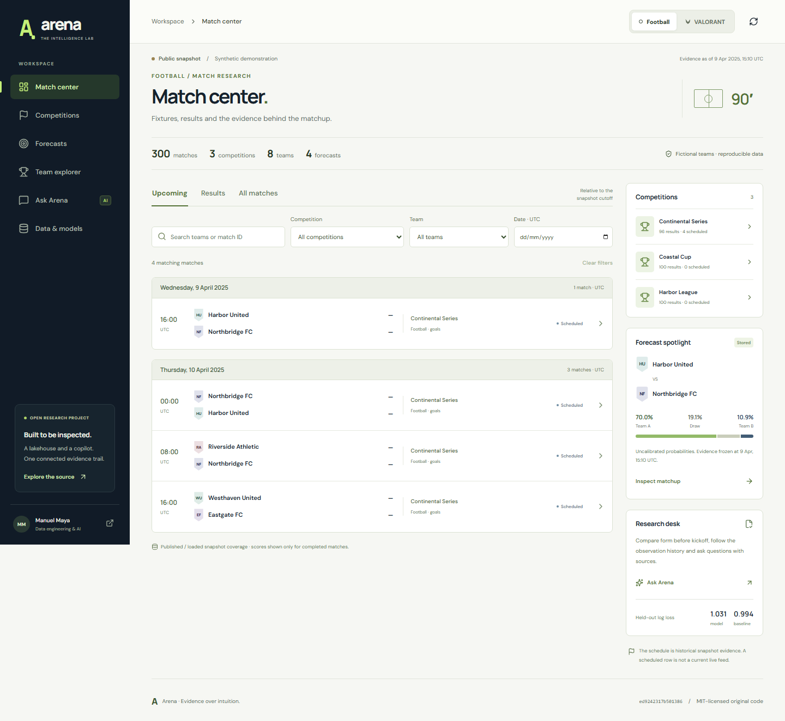

# Arena Copilot

**A match research workspace for football and competitive VALORANT.**

[Run locally](#run-locally) ·
[Project case study](docs/case-study.md) ·
[Snapshot contract](CONTRACT.md) ·
[Data sources and licenses](DATA_SOURCES.md) ·
[Technical evidence](docs/evidence/README.md)

Arena brings the competition calendar, match results, team form and model
forecasts into one workspace. An analyst can move from an event to a match,
compare the teams, and inspect the records behind an answer without losing the
competition context.

The application reads immutable exports from Arena Lakehouse. Its interface and
local assistant use the same validated data; predictions are computed by the
lakehouse model and then explained by the assistant.

## Run locally

The bundled fictional showcase and OpenFootball research fixture work without
provider accounts or Ollama. From the repository root on macOS or Linux, with
Python 3.11 and Node.js 24 installed, start the API.

```bash
python3.11 -m venv .venv
.venv/bin/python -m pip install -e '.[dev]'
.venv/bin/arena-copilot validate
.venv/bin/arena-copilot serve
```

In a second terminal, start the web interface.

```bash
cd web
npm ci
npm run dev
```

Open [the local workspace](http://127.0.0.1:5173) or
[the API reference](http://127.0.0.1:8000/docs). The
[development guide](docs/development.md) covers Windows, Docker, local Ollama
generation, data exports and verification.



## The research workflow

- **Matches:** dated fixtures and results, filtered by sport, competition and team.
- **Current matches:** football fixtures and VALORANT series, source-check
  timestamps, independent date filters and explicit result availability; observed
  league, series and tournament identities organize VALORANT events.
- **Open football:** real community-maintained records across ten imported
  competition editions, including the 2026 World Cup, with source dates,
  result availability, collection history and source-derived team profiles.
- **Events and competitions:** observed coverage, participants, results and
  calculated team tables.
- **Match detail:** scores, format, prior form, head-to-head history and the stored
  forecast when one is available.
- **Ask Arena:** questions answered with document citations and inspectable
  read-only tool results.
- **Data and models:** source lineage, quality incidents, feature definitions and
  model evaluation.

The synthetic football tables use the available results and standard three/one-point scoring.
VALORANT views distinguish series results from maps and rounds. Pre-match
comparisons reconstruct what was known at the cutoff, including source revisions.

The Open football view connects editions, match records and team profiles.
Missing results remain visible as unknown. Match details retain the original
score stages, source reference and collection history; source-scoped questions
return their own citations and trace IDs.

Current matches has its own provider-scoped data path. The measured local
collection contains 2,132 football matches and 106 canonical VALORANT matches.
Scheduled fixtures do not display an initial 0–0 as a played result. Football
scores retain the free provider's delay; VALORANT coverage is match-level rather
than an in-game round feed. A failed source check preserves validated prior rows
with a visible freshness state.

Source announcements with unknown opponents or unconfirmed UTC kickoff remain
in the current calendar. Event metadata comes from the observed source records;
matching labels do not merge distinct events. A resolved announcement keeps its
identity. Conflicting records retain their evidence and cannot become confirmed
scores or assistant context.

[Football data provided by the Football-Data.org API](https://www.football-data.org/).
[Source: PandaScore](https://www.pandascore.co/).

## Architecture

The frontend uses React and TypeScript. Python owns contract validation, analytical
queries and the agent workflow. Retrieval combines SQLite lexical search with
Nomic vector similarity through Reciprocal Rank Fusion. Qwen runs through Ollama;
generation does not require a paid API.

The assistant has bounded read-only tools, a request deadline and a persisted
checkpoint store. Reported forecast percentages are checked against their named
outcomes in the stored distribution. Responses carry citations, tool evidence, a complete snapshot
fingerprint and a trace ID. SQLite records feedback; optional MLflow OSS spans
provide request, retrieval and generation visibility.

Current-data investigations capture one immutable provider dataset and calendar per question.
Their citations, tools, checkpoints and feedback retain that dataset's version
even while the match board refreshes. A changed or mismatched selected record
requires the analyst to refresh before starting an investigation. Unsupported questions produce an explicit
abstention. The [current agent design](docs/live-agent.md) explains the tool and
response boundaries.

## Evidence and scope

The [verification record](docs/evidence/README.md) includes actual Spark-export
compatibility, local-model responses, failed attempts, retrieval measurements,
container checks and desktop/mobile browser journeys. Software fixtures and
actual inference are reported separately.

Version **0.7.0** adds the paired calendar and event directory. Its
[verification report](docs/evidence/current-calendar-v0.7.json) separates local
contract and browser checks from earlier development.

The static build includes the original synthetic showcase and a separate
OpenFootball CC0 research package. The real package contains 2,831 records from
five major European leagues, Brazil, Colombia, Argentina, Libertadores and the
2026 World Cup: 1,192 observed results and 1,639 unknown results at collection.
The World Cup source contains 104 matches and 48 national teams. Imported editions
have different seasons and coverage; they are not a complete live calendar.

The optional Current workspace reads validated exports from a private collector.
Keep provider credentials, raw responses, private datasets, generated display
files and captures out of the source repository. The
[local data guide](docs/current-delivery.md) explains freshness and recovery.

UTC kickoff is derived only for the 104 World Cup records carrying explicit
numeric offsets. Other source dates and local clocks remain unresolved. No
completion instant is inferred. Missing results stay unknown, and revisions become available when
they were actually collected. This research view does not publish forecasts or
official standings. The [research contract](docs/openfootball-research.md)
documents validation and publication boundaries.

Ask Arena uses the synthetic snapshot. Open football has a separate source
assistant for a selected match, team or edition. The public site provides labelled
deterministic evidence summaries; local mode adds Ollama generation and persisted
feedback to each dataset's own agent. Synthetic
forecasts remain uncalibrated and do not establish real-team predictive skill.

The [evaluation corpus](evaluation/README.md) contains 120 draft cases awaiting
human semantic review. Further evaluation and managed-platform work are recorded
in the [roadmap](ROADMAP.md). The [snapshot contract](CONTRACT.md) defines the
interface with the data platform.

Original code and fictional data are licensed under [MIT](LICENSE). The bundled
OpenFootball data is CC0-1.0. See [data sources and licenses](DATA_SOURCES.md)
for provider terms and [model licenses](docs/model-licenses.md) for the optional
model weights.
